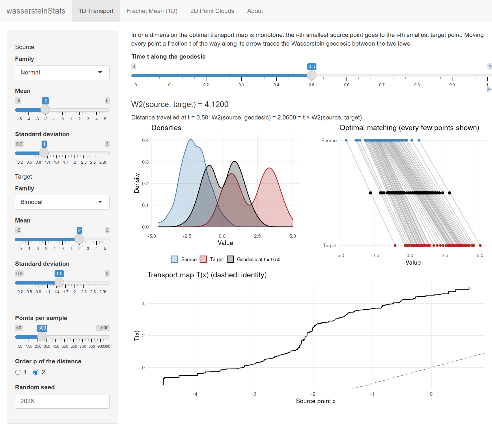

# wassersteinStats

An R package and interactive Shiny app for statistics in Wasserstein space:
optimal transport maps, Wasserstein distances, geodesics, and Fréchet means
(barycenters) of probability distributions on the line and in the plane.

**Live demo:** [seonguk-choi-stat.shinyapps.io/wassersteinStats](https://seonguk-choi-stat.shinyapps.io/wassersteinStats/)

## The app

The app has three tabs, each built on the package functions.

| Tab | What it shows |
|---|---|
| **1D Transport** | Two distributions, their Wasserstein distance, the monotone transport map, and an animated geodesic that morphs one law into the other. |
| **Fréchet Mean (1D)** | The Wasserstein barycenter of several distributions, and gradient descent on the Fréchet functional, iteration by iteration. |
| **2D Point Clouds** | The barycenter of planar point clouds by the fixed-point iteration, with the optimal matching from the barycenter to each cloud. |



Run it locally:

```r
# install.packages("remotes")
remotes::install_github("seonguk-choi-stat/wassersteinStats")
wassersteinStats::run_app()
```

## Functions

| Function | Purpose |
|---|---|
| `wasserstein_1d(x, y, p)` | Exact $W_p$ distance between two samples on the line, of any sizes |
| `transport_map_1d(x, y)` | Monotone optimal transport map $T = F_y^{-1} \circ F_x$ |
| `log_map_1d(gamma, mu)` | Tangent vector $T - \mathrm{id}$ at `gamma` |
| `exp_map_1d(gamma, v, t)` | Push-forward $(\mathrm{id} + t v)_\# \gamma$; geodesics for $t \in [0, 1]$ |
| `frechet_mean_1d(samples)` | Closed-form barycenter: the average of the quantile functions |
| `frechet_mean_1d_descent(samples, step)` | Gradient descent on the Fréchet functional, with its path |
| `wasserstein_2d(x, y, p)` | $W_p$ distance between planar point clouds of equal size (exact assignment) |
| `transport_map_2d(x, y)` | Optimal assignment between planar point clouds |
| `frechet_mean_2d(samples, step)` | Barycenter of planar point clouds by the fixed-point iteration, with its path |

## Example

```r
library(wassersteinStats)

# W_p between samples of different sizes is computed exactly
wasserstein_1d(c(0, 1), c(0, 0.5, 1), p = 1)   # 1/6

# Geodesic between two samples: halfway along the tangent vector
set.seed(1)
gamma <- rnorm(200)
mu <- rexp(200)
v <- log_map_1d(gamma, mu)
midpoint <- exp_map_1d(gamma, v, t = 0.5)
wasserstein_1d(gamma, midpoint) / wasserstein_1d(gamma, mu)   # 0.5

# Barycenter of three samples, in closed form and by gradient descent
samples <- list(rnorm(100, -3), rnorm(100, 0, 2), rnorm(100, 3))
bary <- frechet_mean_1d(samples, n_grid = 100)
fit <- frechet_mean_1d_descent(samples, step = 0.5)
wasserstein_1d(fit$mean, bary)   # close to 0
```

A longer walk-through is in the vignette. Install with
`remotes::install_github("seonguk-choi-stat/wassersteinStats", build_vignettes = TRUE)`,
then run `vignette("statistics-in-wasserstein-space", package = "wassersteinStats")`.

## Reference

Panaretos, V. M., and Zemel, Y. (2020). *An Invitation to Statistics in
Wasserstein Space*. SpringerBriefs in Probability and Mathematical
Statistics. Springer.

## License

MIT © Seonguk Choi
